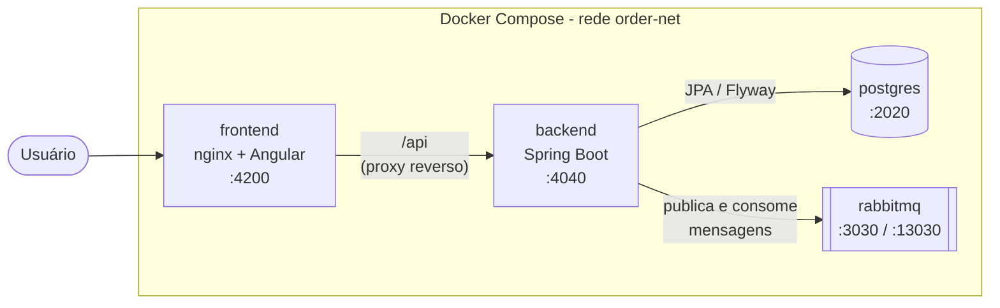
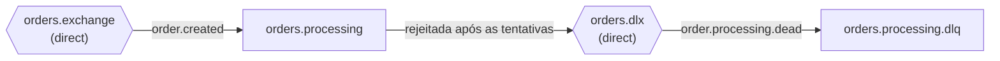
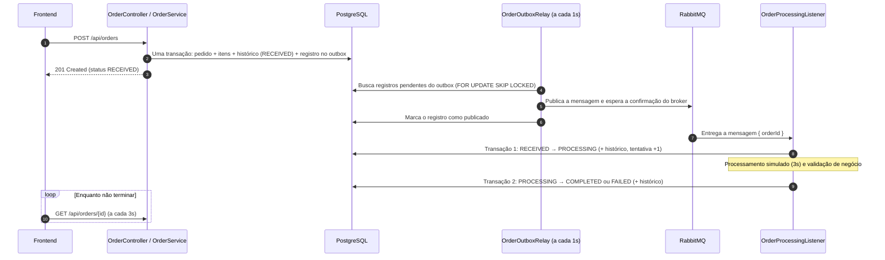
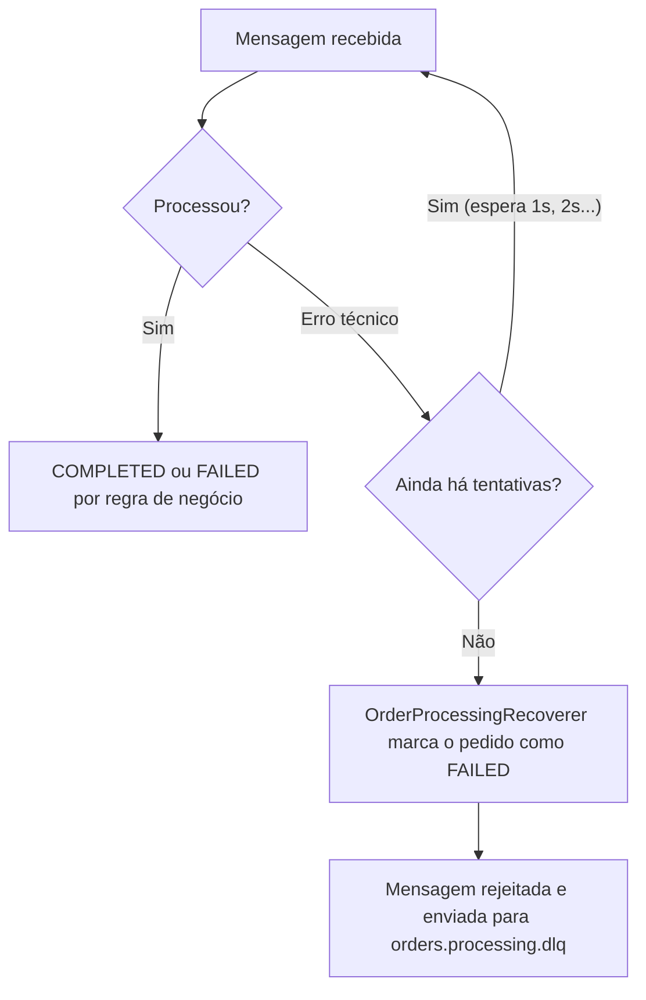
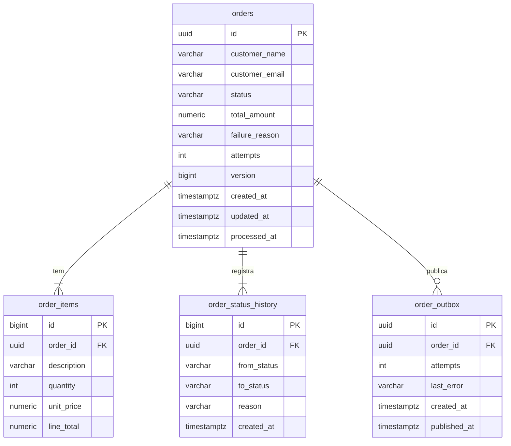

# Orderly


---

Aplicação full stack para cadastrar, consultar e acompanhar pedidos, com o **processamento feito de forma assíncrona** via RabbitMQ.

Quando um pedido é criado, a API responde na hora com o status `RECEIVED`. O processamento acontece depois, em segundo plano, e o pedido passa por `PROCESSING` até terminar em `COMPLETED` ou `FAILED`. O frontend acompanha essa evolução consultando a API periodicamente.

| Camada | Tecnologia |
|---|---|
| Backend | Java 21, Spring Boot 4.1 (Web MVC, Data JPA, Validation, AMQP, Actuator) |
| Banco de dados | PostgreSQL 17 com migrations do Flyway |
| Mensageria | RabbitMQ 4 |
| Frontend | Angular 22 (componentes standalone, signals) servido por nginx |
| Documentação da API | OpenAPI / Swagger UI (springdoc) |
| Infraestrutura | Docker e Docker Compose |

---

## Sumário

1. [Como executar](#1-como-executar)
2. [URLs, portas e credenciais](#2-urls-portas-e-credenciais)
3. [Parar, reiniciar e limpar o ambiente](#3-parar-reiniciar-e-limpar-o-ambiente)
4. [Funcionalidades](#4-funcionalidades)
5. [Testando os cenários de processamento](#5-testando-os-cenários-de-processamento)
6. [API REST](#6-api-rest)
7. [Arquitetura e fluxo de processamento](#7-arquitetura-e-fluxo-de-processamento)
8. [Modelo de dados](#8-modelo-de-dados)
9. [Estrutura do código](#9-estrutura-do-código)
10. [Configuração por variáveis de ambiente](#10-configuração-por-variáveis-de-ambiente)
11. [Testes automatizados](#11-testes-automatizados)
12. [Desenvolvimento local sem Docker](#12-desenvolvimento-local-sem-docker)
13. [Decisões técnicas](#13-decisões-técnicas)
14. [Limitações conhecidas e possíveis evoluções](#14-limitações-conhecidas-e-possíveis-evoluções)

---

## 1. Como executar

**Pré-requisito:** apenas o [Docker](https://docs.docker.com/get-docker/) com o Docker Compose. Não é preciso instalar Java, Node.js, Angular CLI, PostgreSQL ou RabbitMQ.

Na raiz do repositório:

```bash
docker compose up --build
```

O comando:

1. constrói as imagens do backend (Maven dentro do container) e do frontend (Node dentro do container);
2. sobe o PostgreSQL e o RabbitMQ e espera os dois ficarem saudáveis;
3. sobe o backend, que aplica as migrations do banco e cria as filas, exchanges e bindings no RabbitMQ;
4. sobe o frontend quando o backend fica saudável.

Não é necessário nenhum passo manual: o banco, as tabelas e as filas são criados automaticamente. O arquivo `.env` é opcional, pois todas as variáveis têm valores padrão de testes no `compose.yaml`.

A primeira execução demora alguns minutos por causa do download das dependências. Quando os quatro serviços aparecerem como `healthy` em `docker compose ps`, a aplicação está pronta em **http://localhost:4200**.

---

## 2. URLs, portas e credenciais

| Serviço | URL / endereço | Porta no host | Observação |
|---|---|---|---|
| Frontend | http://localhost:4200 | 4200 | Interface web |
| API | http://localhost:4040/api/orders | 4040 | Também acessível pelo frontend em http://localhost:4200/api/orders |
| Swagger UI | http://localhost:4040/swagger-ui.html | 4040 | |
| Health check | http://localhost:4040/actuator/health | 4040 | Mostra o estado do banco e do RabbitMQ |
| RabbitMQ (painel) | http://localhost:13030 | 13030 | Para ver as filas e a DLQ |
| RabbitMQ (AMQP) | `localhost:3030` | 3030 | |
| PostgreSQL | `localhost:2020` | 2020 | Banco `orders` |

**Credenciais de desenvolvimento** (valores padrão, podem ser trocados pelo `.env` antes de buildar o projeto):

| Serviço | Usuário | Senha |
|---|---|---|
| PostgreSQL | `db_user_orders` | `db_password_orders` |
| RabbitMQ | `rabbitmq_user_orders` | `rabbitmq_password_orders` |

> Se alguma porta já estiver em uso na sua máquina, altere a variável correspondente (por exemplo `FRONTEND_PORT=4300`) no `.env` ou na linha de comando. Veja a seção [10](#10-configuração-por-variáveis-de-ambiente).

---

## 3. Parar, reiniciar e limpar o ambiente

| Ação | Comando |
|---|---|
| Subir em segundo plano | `docker compose up --build -d` |
| Ver o estado dos serviços | `docker compose ps` |
| Acompanhar os logs do backend | `docker compose logs -f backend` |
| Parar (mantém os dados) | `docker compose stop` |
| Iniciar de novo depois de parar | `docker compose start` |
| Reiniciar só um serviço | `docker compose restart backend` |
| Remover os containers (mantém os dados) | `docker compose down` |
| Remover containers **e dados** (banco e filas zerados) | `docker compose down -v` |

Os dados do PostgreSQL e do RabbitMQ ficam em volumes Docker (`postgres-data` e `rabbitmq-data`) e sobrevivem a `stop`, `restart` e `down`. Só o `down -v` apaga esses volumes.

> **Importante:** o PostgreSQL e o RabbitMQ só usam as credenciais do `.env` na **primeira** vez que o volume é criado. Se você trocar usuário ou senha depois, rode `docker compose down -v` para recriar os volumes com as novas credenciais.

---

## 4. Funcionalidades

### Gerenciamento de pedidos

- **Criar pedido** com nome do cliente, e-mail e uma lista de itens (descrição, quantidade e preço unitário).
- **O valor total é calculado pelo backend.** Qualquer total enviado pelo cliente é ignorado, o servidor calcula o subtotal de cada item e soma.
- **Consultar um pedido** pelo identificador, com itens, histórico de status, número de tentativas e motivo da falha (quando houver).
- **Listar pedidos** com paginação e ordenação por data de criação, cliente, status ou valor total.
- **Filtrar** por status e por período de criação (data inicial e final, ambas inclusivas).

### Processamento assíncrono

- Ao ser criado, o pedido é gravado no PostgreSQL e uma mensagem é publicada no RabbitMQ. A requisição HTTP não espera o processamento.
- Um consumidor lê a mensagem, muda o pedido para `PROCESSING`, executa uma validação de negócio simulada com tempo configurável e finaliza em `COMPLETED` ou `FAILED`.
- **Falhas de negócio** (pedido recusado) levam o pedido a `FAILED` com o motivo, sem novas tentativas.
- **Falhas técnicas** (erros inesperados) são reprocessadas automaticamente com intervalo crescente entre tentativas. Se todas falharem, o pedido vai para `FAILED` e a mensagem vai para a **Dead Letter Queue (DLQ)**.
- **Mensagens duplicadas são ignoradas:** um pedido já finalizado nunca é processado de novo.
- Cada mudança de status fica registrada no histórico do pedido.

### Interface web

- **Tela de listagem** com tabela, filtros, ordenação por coluna e paginação. Os filtros, a ordenação e a página ficam na URL, então dá para recarregar ou compartilhar o link sem perder o estado.
- **Atualização automática** da listagem a cada 5 segundos, além do botão "Atualizar".
- **Formulário de criação** com vários itens (adicionar e remover linhas), subtotal por item, total estimado, validação nos campos e exibição dos erros devolvidos pela API em cada campo.
- **Tela de detalhes** com dados do cliente, itens, total e linha do tempo do histórico de status. Enquanto o pedido não termina, a tela se atualiza sozinha a cada 3 segundos.
- **Status visual** com cores e ícone pulsando para pedidos em andamento.
- **Feedback** de carregamento (spinners), de sucesso e de erro (notificações no canto da tela).

---

## 5. Testando os cenários de processamento

O processamento simula uma validação de negócio. Use o formulário de criação (ou o Swagger) com os valores abaixo para ver cada cenário:

| Cenário | Como provocar | Resultado esperado |
|---|---|---|
| Sucesso | Qualquer pedido válido, por exemplo `Mouse`, quantidade 1, preço 50 | `RECEIVED` → `PROCESSING` → `COMPLETED` |
| Recusa por regra de negócio | Um item com a palavra **"falha"** na descrição | `FAILED` com o motivo "Item recusado na validação de negócio", com uma única tentativa |
| Recusa por valor | Total acima de **R$ 10.000,00** | `FAILED` com o motivo "Valor do pedido acima do limite de R$ 10.000,00." |
| Falha técnica, retry e DLQ | Um item com a palavra **"instavel"** na descrição | 3 tentativas, depois `FAILED` ("Processamento falhou após todas as tentativas") e a mensagem aparece na fila `orders.processing.dlq` |
| Erro de validação | E-mail inválido, quantidade 0 ou nenhum item | A API responde 400 e o formulário marca o campo com erro |

Cada tentativa leva 3 segundos (`ORDER_PROCESSING_DELAY`). Para ver a DLQ, abra o painel do RabbitMQ em http://localhost:13030, entre com as credenciais acima e vá em **Queues and Streams**.

---

## 6. API REST

A documentação completa e interativa está no **Swagger UI**: http://localhost:4040/swagger-ui.html

| Método | Rota | Descrição | Respostas |
|---|---|---|---|
| `POST` | `/api/orders` | Cria um pedido. Devolve o pedido em `RECEIVED` e o cabeçalho `Location` | 201, 400 |
| `GET` | `/api/orders` | Lista pedidos com paginação, ordenação e filtros | 200, 400 |
| `GET` | `/api/orders/{id}` | Detalhes do pedido, com itens e histórico | 200, 400, 404 |

### Criar pedido

```http
POST /api/orders
Content-Type: application/json

{
  "customerName": "Ana Souza",
  "customerEmail": "ana@email.com",
  "items": [
    { "description": "Mouse sem fio", "quantity": 2, "unitPrice": 89.90 },
    { "description": "Cabo USB-C", "quantity": 1, "unitPrice": 39.90 }
  ]
}
```

Regras de validação:

| Campo | Regra |
|---|---|
| `customerName` | obrigatório, até 150 caracteres |
| `customerEmail` | obrigatório, e-mail válido, até 254 caracteres |
| `items` | mainímo 1, máximo 100 itens |
| `items[].description` | obrigatório, até 255 caracteres |
| `items[].quantity` | obrigatório, mínimo 1 |
| `items[].unitPrice` | obrigatório, não negativo, até 7 dígitos inteiros e 2 casas decimais |

### Listar pedidos

```http
GET /api/orders?status=COMPLETED&createdFrom=2026-10-01&createdTo=2026-10-31&page=0&size=10&sort=totalAmount,desc
```

| Parâmetro | Descrição | Padrão |
|---|---|---|
| `status` | `RECEIVED`, `PROCESSING`, `COMPLETED` ou `FAILED` | todos |
| `createdFrom` / `createdTo` | período de criação no formato `yyyy-MM-dd`, inclusivo | sem filtro |
| `page` | página, começando em 0 | `0` |
| `size` | itens por página (máximo 100) | `10` |
| `sort` | `campo,direção`, com campo `createdAt`, `customerName`, `status` ou `totalAmount` | `createdAt,desc` |

Resposta:

```json
{
  "content": [
    {
      "id": "3f0c...",
      "customerName": "Ana Souza",
      "customerEmail": "ana@email.com",
      "status": "COMPLETED",
      "totalAmount": 219.70,
      "itemCount": 2,
      "createdAt": "2026-10-29T13:00:00Z",
      "updatedAt": "2026-10-29T13:00:04Z"
    }
  ],
  "page": { "size": 10, "number": 0, "totalElements": 1, "totalPages": 1 }
}
```

### Erros

Todos os erros seguem o formato **ProblemDetail**, com `Content-Type: application/problem+json`. Erros de validação trazem a lista `errors` com o campo e a mensagem:

```json
{
  "status": 400,
  "title": "Requisição inválida",
  "detail": "Alguns campos não passaram na validação.",
  "errors": [
    { "field": "items[0].quantity", "message": "A quantidade deve ser no mínimo 1." }
  ]
}
```

| Código | Quando acontece |
|---|---|
| 400 | Corpo inválido, campo com valor inválido, status ou data mal formatados, data inicial depois da final, ordenação por campo não permitido |
| 404 | Pedido não encontrado |
| 500 | Erro inesperado (o detalhe fica só no log do backend) |

---

## 7. Arquitetura e fluxo de processamento

### Componentes



O navegador fala apenas com o nginx do frontend. O nginx repassa `/api` para o backend usando o nome do serviço (`backend:4040`), então não há problema de CORS. Dentro da rede do Docker, o backend acessa `postgres:5432` e `rabbitmq:5672` pelos nomes dos serviços.

### Filas no RabbitMQ



Todas as exchanges e filas são `durable` e são criadas automaticamente pelo backend ao subir.

### Fluxo de um pedido



**Quando o processamento falha por erro técnico:**



---

## 8. Modelo de dados

As tabelas são criadas pelas migrations do Flyway em `backend/src/main/resources/db/migration`.



| Tabela | Para que serve |
|---|---|
| `orders` | Pedido com status atual, total, número de tentativas, motivo da falha e `version` (controle de concorrência). |
| `order_items` | Itens do pedido. Um `CHECK` garante que `line_total = quantity * unit_price`. |
| `order_status_history` | Cada mudança de status, com origem, destino, motivo e data. É o que a linha do tempo da tela de detalhes mostra. |
| `order_outbox` | Mensagens que ainda precisam ser publicadas no RabbitMQ. `published_at` vazio significa pendente; `attempts` e `last_error` registram falhas de publicação. |

Também existem `CHECK`s para os status válidos e para valores não negativos, chaves estrangeiras com `ON DELETE CASCADE` e índices para a listagem (`created_at`, `status + created_at`) e para os registros pendentes do outbox.

---

## 9. Estrutura do código

```
order-platform/
├── compose.yaml          # Orquestra os 4 serviços
├── backend/              # Spring Boot
└── frontend/             # Angular + nginx
```

### Backend (`backend/src/main/java/com/lucasosantana/order_platform`)

Organizado em camadas, com alguns pacotes de apoio:

| Pacote | Responsabilidade |
|---|---|
| `controller` | Endpoints REST (`OrderController`). Só recebe a requisição, valida e delega ao service. |
| `service` | Regras da aplicação: `OrderService` (criação, listagem e consulta) e `OrderProcessingService` (processamento assíncrono). |
| `repository` | Acesso ao banco com Spring Data JPA, incluindo os filtros dinâmicos da listagem (`OrderSpecifications`) e a busca de pendentes do outbox. |
| `model` | Entidades JPA. A entidade `Order` concentra as regras de mudança de status e o cálculo do total. |
| `dto` | Objetos de entrada e saída da API. Separam o contrato da API das entidades do banco. |
| `mapper` | Conversão de entidades para DTOs. |
| `messaging` | Tudo que envolve o RabbitMQ: mensagem, publicador, relay do outbox, consumidor e recuperação após as tentativas. Mantém a mensageria separada das regras de negócio. |
| `config` | Configurações: topologia do RabbitMQ, CORS, agendamento e OpenAPI. |
| `exception` | Exceções da aplicação e o `GlobalExceptionHandler`, que transforma tudo em ProblemDetail. |

Os pacotes `dto`, `mapper`, `messaging`, `config` e `exception` existem para que nenhuma camada precise conhecer detalhes que não são dela: o controller não conhece entidades, o service não conhece o RabbitMQ diretamente (ele só grava no outbox) e o consumidor não conhece HTTP.

### Frontend (`frontend/src/app`)

Organizado por funcionalidade, seguindo as convenções do Angular:

| Pasta | Responsabilidade |
|---|---|
| `core/` | Itens usados pela aplicação inteira: tratamento de erros HTTP (`api-error.ts`), URL base da API e o serviço de notificações (toasts). |
| `shared/` | Peças reutilizáveis sem regra de negócio: paginação, spinner, validadores de formulário e o tipo `Page`. |
| `features/orders/models/` | Interfaces e tipos que representam os contratos da API (`Order`, `OrderSummary`, `CreateOrderRequest`...) e os parâmetros da listagem. |
| `features/orders/data-access/` | Comunicação com a API. `OrdersApi` é o contrato; `http/` é a implementação com `HttpClient` e `mock/` uma implementação em memória para testar a aplicação sem backend. |
| `features/orders/pages/` | Telas (listagem, criação e detalhes). Cuidam de carregar dados, polling, navegação e feedback. |
| `features/orders/components/` | Componentes de apresentação (tabela, filtros, formulário, badge de status, linha do tempo). Recebem dados por `input()` e avisam ações por `output()`, sem chamar a API. |
| `features/orders/utils/` | Funções puras, como o cálculo do total estimado mostrado no formulário. |

Para trocar entre a API real e os dados simulados, altere uma linha em `frontend/src/app/app.config.ts`:

```ts
provideOrdersApi('http'),   // backend real
provideOrdersApi('mock'),   // dados em memória, sem backend
```

---

## 10. Configuração por variáveis de ambiente

Todas as configurações têm valores padrão adequados para rodar localmente. Para alterar, crie um arquivo `.env` na raiz (ao lado do `compose.yaml`) ou passe as variáveis na linha de comando.

**Usadas pelo `compose.yaml`:**

| Variável | Padrão | Descrição |
|---|---|---|
| `FRONTEND_PORT` | `4200` | Porta do frontend no host |
| `BACKEND_PORT` | `4040` | Porta da API no host |
| `DB_EXPOSED_PORT` | `2020` | Porta do PostgreSQL no host |
| `RABBITMQ_EXPOSED_PORT` | `3030` | Porta AMQP do RabbitMQ no host |
| `RABBITMQ_MANAGEMENT_PORT` | `13030` | Porta do painel do RabbitMQ no host |
| `DB_NAME` / `DB_USER` / `DB_PASSWORD` | `orders` / `db_user_orders` / `db_password_orders` | Banco e credenciais do PostgreSQL |
| `RABBITMQ_USER` / `RABBITMQ_PASSWORD` | `rabbitmq_user_orders` / `rabbitmq_password_orders` | Credenciais do RabbitMQ |
| `ORDER_PROCESSING_DELAY` | `3000ms` | Tempo de cada tentativa de processamento |
| `ORDER_PROCESSING_MAX_RETRIES` | `2` | Novas tentativas após a primeira (2 = 3 tentativas no total) |
| `CORS_ALLOWED_ORIGINS` | `http://localhost:4200` | Origens permitidas para chamar a API diretamente |

Exemplo de `.env`:

```env
FRONTEND_PORT=4200
BACKEND_PORT=4040
ORDER_PROCESSING_DELAY=3000ms
ORDER_PROCESSING_MAX_RETRIES=2
```

**Outras opções do backend** (em `application.properties`, também podem ser definidas por variável de ambiente):

| Variável | Padrão | Descrição |
|---|---|---|
| `ORDER_PROCESSING_MAX_TOTAL_AMOUNT` | `10000.00` | Valor acima do qual o pedido é recusado |
| `ORDER_PROCESSING_RETRY_INITIAL_INTERVAL` | `1000ms` | Espera antes da primeira nova tentativa (dobra a cada tentativa, até 10s) |
| `OUTBOX_RELAY_INTERVAL` | `1s` | Intervalo entre as execuções do relay do outbox |
| `OUTBOX_BATCH_SIZE` | `50` | Quantos registros do outbox o relay publica por execução |
| `RABBITMQ_PUBLISH_CONFIRM_TIMEOUT` | `5s` | Tempo máximo de espera pela confirmação do RabbitMQ |
| `APP_TIME_ZONE` | `America/Sao_Paulo` | Fuso usado para interpretar os filtros de data |

Para usar uma delas com o Docker, adicione a variável na seção `environment` do serviço `backend` no `compose.yaml`.

---

## 11. Testes automatizados

### Backend

**Pré-requisitos:** Java 21 e Docker rodando. Os testes de integração usam [Testcontainers](https://testcontainers.com/), que sobe um PostgreSQL e um RabbitMQ reais e temporários; não é preciso subir o `docker compose`.

```bash
cd backend
./mvnw test          # Linux / macOS / Git Bash
mvnw.cmd test        # Windows (cmd ou PowerShell)
```

| Classe | Tipo | O que cobre |
|---|---|---|
| `OrderControllerTest` | Camada web (sem banco) | Formato da página, status inválido, 404 em ProblemDetail, erros de validação por campo |
| `OrderQueryIntegrationTest` | Integração (PostgreSQL) | Filtro por status e período (incluindo fuso horário), ordenação com paginação, data inicial depois da final, detalhes com itens e histórico |
| `OrderCreateIntegrationTest` | Integração (PostgreSQL + RabbitMQ) | Total calculado no servidor e outbox gravado; nada é salvo se a transação falhar; registro do outbox continua pendente se a publicação falhar |
| `OrderProcessingIntegrationTest` | Fluxo completo | Pedido concluído; falha de negócio sem nova tentativa; retry com DLQ; mensagem duplicada ignorada |

### Frontend

**Pré-requisitos:** Node.js 24 e npm.

```bash
cd frontend
npm install
npm test -- --watch=false
```

| Arquivo | O que cobre |
|---|---|
| `order-form.spec.ts` | Formulário com vários itens: validação, adicionar e remover itens com atualização do total estimado, envio sem campo de total e exibição dos erros devolvidos pela API |
| `order-list-query.spec.ts` | Conversão dos filtros, da ordenação e da página entre a URL e a consulta |

---

## 12. Desenvolvimento local sem Docker

Útil para alterar o código e ver o resultado sem reconstruir as imagens. O banco e o RabbitMQ continuam no Docker.

**Pré-requisitos:** Java 21, Node.js 24 e Docker.

```bash
# 1. Sobe só o banco e o RabbitMQ
docker compose up -d postgres rabbitmq

# 2. Backend (em um terminal) - usa localhost:2020 e localhost:3030 por padrão
cd backend
./mvnw spring-boot:run

# 3. Frontend (em outro terminal)
cd frontend
npm install
npm start
```

O frontend fica em http://localhost:4200 e o `ng serve` repassa as chamadas `/api` para http://localhost:4040 (configurado em `frontend/proxy.conf.json`).

> Se o `npm start` disser que a porta 4200 está em uso, provavelmente o container do frontend está rodando. Pare-o com `docker compose stop frontend`.

---

## 13. Decisões técnicas

### Outbox transacional

Gravar o pedido no banco e publicar no RabbitMQ são duas operações em sistemas diferentes. Se a aplicação publicasse direto na requisição, uma falha entre as duas deixaria um pedido sem mensagem (nunca processado) ou uma mensagem sem pedido.

A solução foi o padrão **outbox**: na mesma transação em que o pedido é salvo, é gravado também um registro na tabela `order_outbox`. Ou tudo é salvo, ou nada. Um job agendado (`OrderOutboxRelay`) lê os registros pendentes e publica no RabbitMQ, esperando a confirmação do broker (*publisher confirms*) antes de marcá-los como publicados. Se o RabbitMQ estiver fora do ar, o pedido é criado normalmente e a mensagem é publicada quando ele voltar.

A busca usa `FOR UPDATE SKIP LOCKED`, o que permite rodar mais de uma instância do backend sem publicar o mesmo registro duas vezes.

### Entrega "pelo menos uma vez" e consumidor idempotente

O outbox garante que a mensagem será publicada, mas não que será publicada **só uma vez**: se o broker confirmar e o banco falhar antes de marcar o registro, ele é publicado de novo. O RabbitMQ também pode reentregar mensagens. Por isso o consumidor foi feito para ignorar repetições:

- antes de processar, verifica se o pedido já está finalizado (`COMPLETED` ou `FAILED`) e, se estiver, ignora a mensagem;
- a coluna `version` (`@Version` do JPA) impede que duas execuções simultâneas finalizem o mesmo pedido: a segunda falha ao gravar, é tentada de novo, encontra o pedido finalizado e é ignorada.

O `orderId` funciona como chave de idempotência natural, então não foi necessário criar uma chave extra na mensagem.

### Mensagem com apenas o identificador

A mensagem leva só o `orderId`. O consumidor lê o estado atual no banco, que é a fonte da verdade, e por isso uma mensagem atrasada ou repetida nunca traz dados desatualizados.

### Duas transações curtas no processamento

O consumidor muda o pedido para `PROCESSING` em uma transação, processa fora de transação e grava o resultado em outra. Assim o status `PROCESSING` fica visível para o frontend durante o processamento, e nenhuma linha do banco fica travada durante a espera.

### Falha de negócio x falha técnica

- **Falha de negócio** (pedido recusado): é um resultado válido. O pedido vai para `FAILED` com o motivo, sem novas tentativas, porque tentar de novo daria o mesmo resultado.
- **Falha técnica** (exceção): pode ser passageira. O Spring AMQP tenta de novo com intervalo crescente e, esgotadas as tentativas, o `OrderProcessingRecoverer` marca o pedido como `FAILED` e rejeita a mensagem, que vai para a DLQ para análise.

### Total calculado pelo servidor

O total é sempre a soma de `quantidade × preço` de cada item, calculada na entidade `Order`. O frontend mostra um total estimado apenas como referência. O banco reforça a regra com um `CHECK` em `line_total`.

### Paginação, ordenação e filtros no servidor

Como a paginação é feita no banco, a ordenação também precisa ser. Ordenar só a página atual no navegador daria um resultado errado. A ordenação aceita apenas campos conhecidos e usa o `id` como desempate, para que nenhum pedido se repita ou suma entre páginas. Os filtros de data consideram o dia inteiro no fuso configurado (`America/Sao_Paulo`).

### Erros padronizados

Todos os erros seguem o ProblemDetail, com mensagens em português. Erros de validação trazem o caminho do campo (por exemplo `items[0].quantity`), que o formulário usa para marcar o campo certo.

### Frontend com contrato da API e implementação trocável

As telas dependem só da classe abstrata `OrdersApi`. Isso permitiu construir e testar as telas com dados simulados antes do backend existir, e trocar para a API real mudando uma linha.

### Proxy reverso no nginx

O frontend é servido pelo nginx, que também repassa `/api` e `/swagger-ui` para o backend. O navegador fala com uma única origem, o que evita CORS e esconde a porta do backend.

---

## 14. Limitações conhecidas e possíveis evoluções

### Limitações

- **Paginação por offset:** cada página faz um `count(*)` para calcular o total. Com milhões de registros isso ficaria lento.
- **Processamento simulado:** a validação de negócio usa regras fixas (palavras-chave e valor máximo) apenas para demonstrar os cenários.
- **Mensagens na DLQ não são reprocessadas automaticamente:** ficam na fila para análise manual.

### Possíveis evoluções

- Paginação por cursor (*keyset pagination*) para grandes volumes.
- Índices para ordenação por cliente e por valor.
- Atualização em tempo real, no lugar do polling.
- Tela ou endpoint para reprocessar mensagens da DLQ.
- Testes end-to-end do frontend (por exemplo, Playwright).
